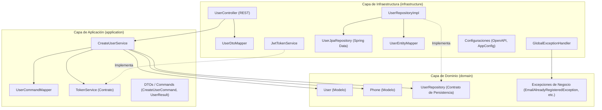
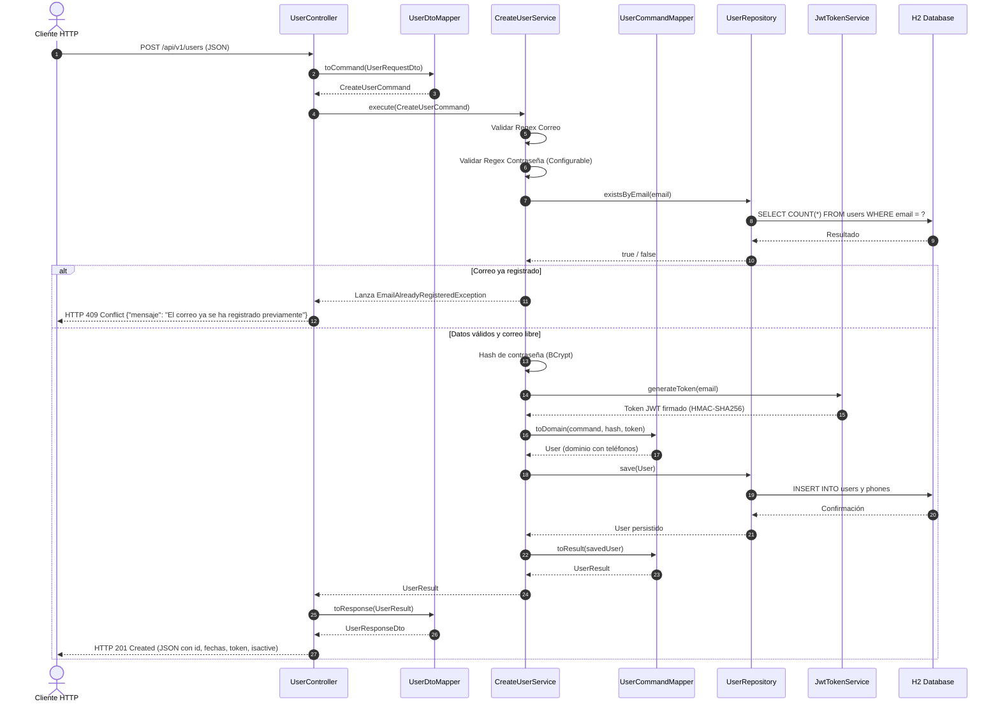

# API RESTful de Creación y Gestión de Usuarios

Este proyecto implementa una API RESTful para el registro y gestión de usuarios, desarrollada sobre **Spring Boot** utilizando los principios de **Arquitectura Limpia (Clean Architecture)** sin sobrecarga de adaptadores, **Java 17**, persistencia en memoria con **H2**, autenticación y generación de **JWT**, pruebas unitarias con **Spock Framework** (Groovy) y pruebas de integración BDD con **Cucumber** (Gherkin).

---

## 1. Diagramas de la Solución

### 1.1. Arquitectura Limpia por Capas
La solución se organiza en 3 capas desacopladas con flujo unidireccional de dependencias hacia el dominio central:



### 1.2. Flujo de Secuencia: Registro de Usuario (`POST /api/v1/users`)



---

## 2. Enfoque de Arquitectura Limpia

Se adoptó una **Arquitectura Limpia directa y pragmática** que elimina la sobrecarga de paquetes redundantes (`adapter.input`, `adapter.output`, `port.in`, `port.out`):

- **`domain`**: El núcleo de la lógica de negocio. Contiene los modelos puros (`User`, `Phone`), el contrato de repositorio (`UserRepository`) y las excepciones de dominio (`EmailAlreadyRegisteredException`, `InvalidUserDataException`). Es 100% independiente de frameworks de presentación y persistencia.
- **`application`**: Orquesta los casos de uso. Contiene `CreateUserService`, mappers de aplicación ([`UserCommandMapper`](file:///D:/Documentos/Repos/demo/src/main/java/com/user/demo/application/mapper/UserCommandMapper.java)), contratos de servicios auxiliares como `TokenService` y los DTOs internos (`CreateUserCommand`, `UserResult`, `PhoneResult`).
- **`infrastructure`**: Concreta las interacciones con el exterior:
  - `controller`: Controlador REST ([`UserController`](file:///D:/Documentos/Repos/demo/src/main/java/com/user/demo/infrastructure/controller/UserController.java)), DTOs de petición/respuesta, mappers desacoplados ([`UserDtoMapper`](file:///D:/Documentos/Repos/demo/src/main/java/com/user/demo/infrastructure/controller/mapper/UserDtoMapper.java)) y el manejador global de excepciones ([`GlobalExceptionHandler`](file:///D:/Documentos/Repos/demo/src/main/java/com/user/demo/infrastructure/controller/GlobalExceptionHandler.java)).
  - `persistence`: Entidades JPA (`UserEntity`, `PhoneEntity`), interfaz Spring Data JPA (`UserJpaRepository`), mappers entidad-dominio ([`UserEntityMapper`](file:///D:/Documentos/Repos/demo/src/main/java/com/user/demo/infrastructure/persistence/mapper/UserEntityMapper.java)) y la implementación [`UserRepositoryImpl`](file:///D:/Documentos/Repos/demo/src/main/java/com/user/demo/infrastructure/persistence/UserRepositoryImpl.java) que satisface el contrato del dominio.
  - `security`: Emisor de tokens JWT ([`JwtTokenService`](file:///D:/Documentos/Repos/demo/src/main/java/com/user/demo/infrastructure/security/JwtTokenService.java)).
  - `config`: Configuración de Swagger/OpenAPI y beans del sistema.

---

## 3. Requisitos Previos

- **JDK**: Java 17 o superior.
- **Gradle**: Se incluye el Gradle Wrapper (`gradlew` / `gradlew.bat`), no requiere instalación externa.

---

## 4. Compilación y Ejecución

### 4.1. Compilar el proyecto
```bash
./gradlew compileJava
```
*(En Windows PowerShell: `.\gradlew.bat compileJava`)*

### 4.2. Ejecutar la suite completa de pruebas (Spock + Cucumber)
```bash
./gradlew test
```
*(En Windows PowerShell: `.\gradlew.bat test`)*

### 4.3. Iniciar la aplicación
```bash
./gradlew bootRun
```
*(En Windows PowerShell: `.\gradlew.bat bootRun`)*

La aplicación iniciará en el puerto `8080`.

---

## 5. Documentación Interactiva (Swagger / OpenAPI)

Una vez iniciada la aplicación, se puede acceder a la interfaz Swagger UI en:

- **Swagger UI**: [http://localhost:8080/swagger-ui.html](http://localhost:8080/swagger-ui.html)
- **OpenAPI JSON**: [http://localhost:8080/v3/api-docs](http://localhost:8080/v3/api-docs)

---

## 6. Base de Datos en Memoria (H2)

- **Tipo**: En memoria (`jdbc:h2:mem:userdb`).
- **Script de creación**: [`src/main/resources/schema.sql`](file:///D:/Documentos/Repos/demo/src/main/resources/schema.sql) se ejecuta automáticamente en el arranque para crear las tablas `users` y `phones`.
- **Consola H2**: [http://localhost:8080/h2-console](http://localhost:8080/h2-console)
  - **JDBC URL**: `jdbc:h2:mem:userdb`
  - **Usuario**: `sa`
  - **Contraseña**: *(en blanco)*

---

## 7. Configuración de Expresión Regular para Contraseñas

El requerimiento exige que **el valor de la expresión regular sea configurable**. Se gestiona directamente desde [`src/main/resources/application.yaml`](file:///D:/Documentos/Repos/demo/src/main/resources/application.yaml):

```yaml
app:
  security:
    jwt:
      secret: "404E635266556A586E3272357538782F413F4428472B4B6250645367566B5970"
      expiration-ms: 86400000 # 24 horas
    # Expresión regular configurable para validación de contraseñas:
    # Ejemplo por defecto: al menos 1 mayúscula, 1 minúscula, 1 dígito y longitud mínima de 6 caracteres.
    password-regex: "^(?=.*[0-9])(?=.*[a-z])(?=.*[A-Z]).{6,}$"
  validation:
    # Expresión regular para correo electrónico:
    email-regex: "^[a-zA-Z0-9._%+-]+@[a-zA-Z0-9.-]+\\.[a-zA-Z]{2,}$"
```

Cualquier cambio a la propiedad `app.security.password-regex` es absorbido automáticamente por el servicio de validación sin necesidad de modificar el código fuente.

---

## 8. Consideraciones de Seguridad y Gestión de Secretos

> [!NOTE]
> **Facilidad de Ejecución (Plug-and-Play)**:
> Por fines prácticos de la prueba técnica y para garantizar que la aplicación y sus pruebas automatizadas (Spock y Cucumber) se ejecuten de manera inmediata sin requerir configuración previa en el entorno local del evaluador, se han dejado valores por defecto predefinidos en [`src/main/resources/application.yaml`](file:///D:/Documentos/Repos/demo/src/main/resources/application.yaml) para la clave secreta de JWT (`app.security.jwt.secret`) y las credenciales de la base de datos H2 en memoria (`spring.datasource.username` / `password`).

> [!IMPORTANT]
> **Buenas Prácticas para Ambientes Productivos**:
> En arquitecturas empresariales y entornos de producción reales, **nunca se deben versionar credenciales ni secretos en texto plano dentro del repositorio**. Se recomienda implementar alguna de las siguientes alternativas estándar de la industria:
> 1. **Variables de Entorno (12-Factor App)**: Inyectar los valores dinámicamente mediante variables del sistema operativo o contenedores Docker (p. ej. `${JWT_SECRET}` y `${DB_PASSWORD}`).
> 2. **Gestores de Secretos Centralizados (Cloud Native)**: Utilizar servicios como **HashiCorp Vault**, **AWS Secrets Manager**, **Azure Key Vault** o **Google Cloud Secret Manager** mediante los conectores de Spring Cloud.
> 3. **Cifrado en Repositorio**: Emplear herramientas de cifrado como **Jasypt** (`ENC(...)`) donde la clave maestra de desencriptación se provee externamente al inicio de la JVM.

---

## 9. Formato de Endpoints y Ejemplos `curl`

### 9.1. Registro de Usuario Exitoso

**Petición**:
```bash
curl -X POST http://localhost:8080/api/v1/users \
  -H "Content-Type: application/json" \
  -d '{
    "name": "Juan Rodriguez",
    "email": "juan@rodriguez.org",
    "password": "Hunter2",
    "phones": [
      {
        "number": "1234567",
        "citycode": "1",
        "contrycode": "57"
      }
    ]
  }'
```

**Respuesta Exitosa (HTTP 201 Created)**:
```json
{
  "id": "e4a7a8d5-3ef3-40f0-8bf1-f18c645d9472",
  "created": "2026-10-08T22:15:00",
  "modified": "2026-10-08T22:15:00",
  "last_login": "2026-10-08T22:15:00",
  "token": "eyJhbGciOiJIUzI1NiIsInR5cCI6IkpXVCJ9.eyJzdWIiOiJqdWFuQHJvZHJpZ3Vlei5vcmciLCJpYXQiOjE3OTIxNjYxMDAsImV4cCI6MTc5MjI1MjUwMH0.m7rZ...",
  "isactive": true
}
```

### 9.2. Error: Correo ya Registrado

**Petición con un correo ya existente**:
```bash
curl -X POST http://localhost:8080/api/v1/users \
  -H "Content-Type: application/json" \
  -d '{
    "name": "Juan Duplicado",
    "email": "juan@rodriguez.org",
    "password": "Hunter2"
  }'
```

**Respuesta (HTTP 409 Conflict)**:
```json
{
  "mensaje": "El correo ya se ha registrado previamente"
}
```

### 9.3. Error: Contraseña que no cumple la Regex Configurable

**Petición con contraseña débil (ej. "123")**:
```bash
curl -X POST http://localhost:8080/api/v1/users \
  -H "Content-Type: application/json" \
  -d '{
    "name": "Usuario Test",
    "email": "test@dominio.cl",
    "password": "123"
  }'
```

**Respuesta (HTTP 400 Bad Request)**:
```json
{
  "mensaje": "El formato de la contraseña es inválido"
}
```

### 9.4. Error: Formato de Correo Inválido

**Petición con correo mal formado**:
```bash
curl -X POST http://localhost:8080/api/v1/users \
  -H "Content-Type: application/json" \
  -d '{
    "name": "Usuario Test",
    "email": "correo-invalido",
    "password": "Hunter2"
  }'
```

**Respuesta (HTTP 400 Bad Request)**:
```json
{
  "mensaje": "El formato del correo es inválido"
}
```

---

## 10. Pruebas Automatizadas

El proyecto cuenta con dos suites de pruebas complementarias:

### 10.1. Pruebas Unitarias con Spock Framework (Groovy)
Ubicadas en `src/test/groovy`:
- [`CreateUserServiceSpec.groovy`](file:///D:/Documentos/Repos/demo/src/test/groovy/com/user/demo/application/service/CreateUserServiceSpec.groovy):
  - Verifica creación exitosa de usuario y hashing de contraseña.
  - Verifica lanzamiento de `EmailAlreadyRegisteredException` con mensaje `"El correo ya se ha registrado previamente"`.
  - Pruebas parametrizadas (`where:`) para validación de patrones regex de correo y contraseñas.
- [`UserCommandMapperSpec.groovy`](file:///D:/Documentos/Repos/demo/src/test/groovy/com/user/demo/application/mapper/UserCommandMapperSpec.groovy):
  - Verifica el mapeo de `CreateUserCommand` a `User` (dominio) y de `User` a `UserResult`.
- [`UserDtoMapperSpec.groovy`](file:///D:/Documentos/Repos/demo/src/test/groovy/com/user/demo/infrastructure/controller/mapper/UserDtoMapperSpec.groovy):
  - Verifica el mapeo bidireccional entre DTOs HTTP y comandos/resultados de aplicación.
- [`JwtTokenServiceSpec.groovy`](file:///D:/Documentos/Repos/demo/src/test/groovy/com/user/demo/infrastructure/security/JwtTokenServiceSpec.groovy):
  - Verifica estructura y emisión de token JWT firmado.

### 10.2. Pruebas de Integración BDD con Cucumber
Ubicadas en `src/test/resources/features` y `src/test/java/com/user/demo/cucumber`:
- [`user_registration.feature`](file:///D:/Documentos/Repos/demo/src/test/resources/features/user_registration.feature):
  - **Escenario 1**: Registro exitoso con validación de status 201, UUID, JWT, campos de auditoría e `isactive`.
  - **Escenario 2**: Intento de duplicidad con status 409 y mensaje exacto `"El correo ya se ha registrado previamente"`.
  - **Escenario 3**: Error 400 ante formato de correo inválido.
  - **Escenario 4**: Error 400 ante contraseña no conforme a la regex configurable.
- Reporte HTML generado automáticamente en `build/reports/cucumber/cucumber.html`.
